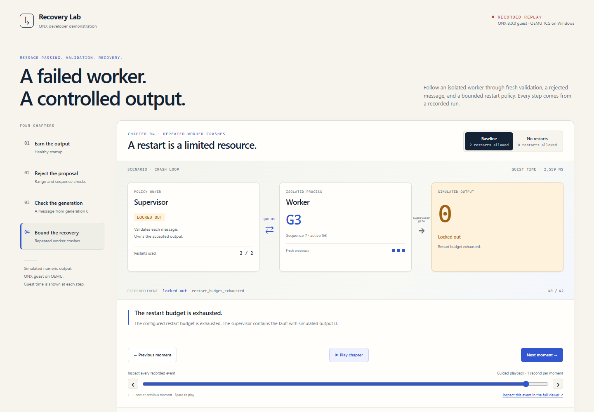

# QNX Recovery Lab

A fault-injection lab that shows what happens to an output while a QNX worker fails and recovers. A separate supervisor validates messages, holds a simulated output at zero during recovery, and requires three fresh proposals before a replacement worker can resume output.

The native C program runs on **QNX 8.0**. The viewer and guided demo replay actual guest recordings. Seven scenarios cover healthy operation, crash, stall, an out-of-range command, repeated crashes, a repeated sequence, and a mismatched generation.



## Try the recorded demo

Requires Python 3.12. No QNX SDK, Node packages or network connection are needed to inspect the included evidence.

```sh
python prototype/serve.py
```

Open [the guided demo](http://127.0.0.1:8764/demo/), [the full trace viewer](http://127.0.0.1:8764/viewer/), or [the video player](http://127.0.0.1:8764/demo/video.html). The server listens only on `127.0.0.1` and supports video seeking. You can also open [prototype/demo/offline.html](prototype/demo/offline.html) directly from disk.

**Start guided tour** walks through 20 recorded decisions across both restart policies. Pause or resume from the chapter navigation or transport controls. Manual navigation resets the tour; Escape pauses playback. Presentation pauses adapt to the explanation length and reduced-motion preference, while guest timestamps remain unchanged.

The [recorded walkthrough](prototype/demo/media/demo.webm) has [English captions](prototype/demo/media/demo.vtt), with explanations also visible in the UI. [Presenter notes](prototype/DEMO.md) identify its execution and replay sections.

The 2m38s movie opens with a new QNX guest run, observed live through serial output, then moves to the recorded workbench. The new run passed seven scenarios with 203 events. Its [capture receipt](prototype/artifacts/demo-native-capture.json), raw log and source snapshot are included; the portable demo also carries them under `data/native`.

The **recorded response** table compares fault-notice-to-hold and hold-to-validated-resume or lockout intervals for both policies, including each repeated-crash cycle. These are measurements from the selected QNX/QEMU recordings.

## What runs on QNX

The supervisor creates a QNX channel, receives proposals and timer pulses, and owns the accepted output. A worker is a separate spawned process using synchronous QNX messages. Receipt acknowledgement and command acceptance are separate decisions.

Messages are checked for sender, size, protocol, generation, sequence, value range and freshness. A detected injected fault holds output at zero before a bounded restart. The replacement must send three fresh proposals. Exhausting the restart budget produces `locked_out` with output zero.

The program uses `ChannelCreate`, `ConnectAttach`, `MsgSend`, `MsgReceive`, `MsgReply`, `TimerTimeout`, timer pulses, `posix_spawn`, and `waitpid`. [Architecture](docs/architecture.md) describes the state machine and boundaries.

The supplied worker is a built-in reference implementation. [Integration boundaries](docs/integration.md) explain its current protocol, acknowledgement versus acceptance, and the source changes and new target checks needed to adapt it to an application.

## Reproduce a native run

The tested host uses Windows, PowerShell 7, QNX SDP 8.0 with GCC 12.2.0, and QEMU 11.1.0. The guest is QNX 8.0.0 x86pc under TCG, with one CPU, 512 MiB RAM and networking disabled. Obtain the SDK license and QEMU separately.

```powershell
.\prototype\run-lab.ps1 `
  -SdkRoot 'C:\QNX\qnx800' `
  -QemuRoot 'C:\Program Files\qemu'
```

The first run builds the native executable and guest image, boots QNX, records console events, checks them, exports reports, and stops the guest. Local SDKs, VM images and tools live outside tracked source. See [complete reproduction instructions](docs/reproduce.md) and [runner details](prototype/README.md), including configuration and `-SkipBuild` requirements.

## Recorded results

The demo pins two independently checked recordings with `fault_at=8` and `watchdog_ms=700`. Only the restart budget differs.

| Recording | Events | Restart budget | Observed outcomes |
|---|---:|---:|---|
| Baseline | 203 | 2 | Healthy operation, five recovered faults, repeated-crash containment |
| No restarts | 112 | 0 | Healthy operation, six contained faults at output zero |

Raw logs, JSON traces and source snapshots accompany the recordings. The checker derives transitions and counts from events. The exporter matches those events to the raw console, checks successful guest exit markers and hashes, and emits Markdown and JUnit reports. These checks establish internal consistency of local evidence, not independent execution attestation.

A separate 300 ms watchdog stress run failed in the healthy scenario after a 332 ms gap without an accepted proposal under QEMU. Its failed trace is retained. The numeric output is simulated; these emulation measurements establish neither hardware timing bounds nor production safety.

## Check and rebuild the evidence presentation

```sh
python -m unittest discover -s prototype/tests -v
python prototype/check_trace.py
python prototype/export_report.py
python prototype/build_demo.py --include-media
```

The Python checks use the standard library. Regression fixtures include earlier guest traces and explicitly synthetic mutations. On hosts without permission to create symbolic links, the corresponding server tests are skipped. The GitHub workflow runs host checks; it does not boot QNX or activate an SDK license.

The project preserves tracked file bytes across checkouts because evidence and demo receipts contain SHA-256 digests. Generated guest binaries, licensed images, dependencies, private working notes and local credentials are ignored.

`python tools/package_source.py --check` audits reviewed tracked files. `python tools/package_source.py` writes a source ZIP with per-file digests to the ignored `outputs` directory. It excludes Git metadata and rejects local tool directories, executable files and common private-data patterns. It is a packaging check, not a guarantee that arbitrary future files are safe to publish.

## Optional screencast tooling

Node 20 or later and an installed Chrome are needed only to repeat the browser recording.

```sh
npm ci
npx playwright install ffmpeg
node prototype/tools/record-demo.cjs
python prototype/build_demo.py --include-media
```

Keep the local server running while recording. These commands use a separate headless browser context. [Reproduction notes](docs/reproduce.md) cover the optional local browser cache.

With an installed Chrome and `npm ci`, run `npm run test:browser` against the local server to check the recorded event displays, guided tour, offline page, responsive bounds and automated accessibility rules. This check uses an isolated headless browser and writes its report to the ignored `work` directory.

## Submission materials

[English project description](submission/project-description.md), [Ukrainian summary](submission/project-description.uk.md), and [submission readiness](submission/readiness.md) are local drafts. Public repository and YouTube URLs have not been created. The full competition rules, assistance disclosure requirements and acceptance of a recorded-UI demonstration still need confirmation before submission.

## License

[MIT](LICENSE) for this project's own materials. Separately installed QNX tools, QEMU, browser and recording dependencies retain their own terms; see [third-party notices](THIRD_PARTY_NOTICES.md).
