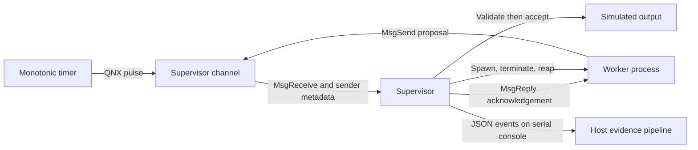
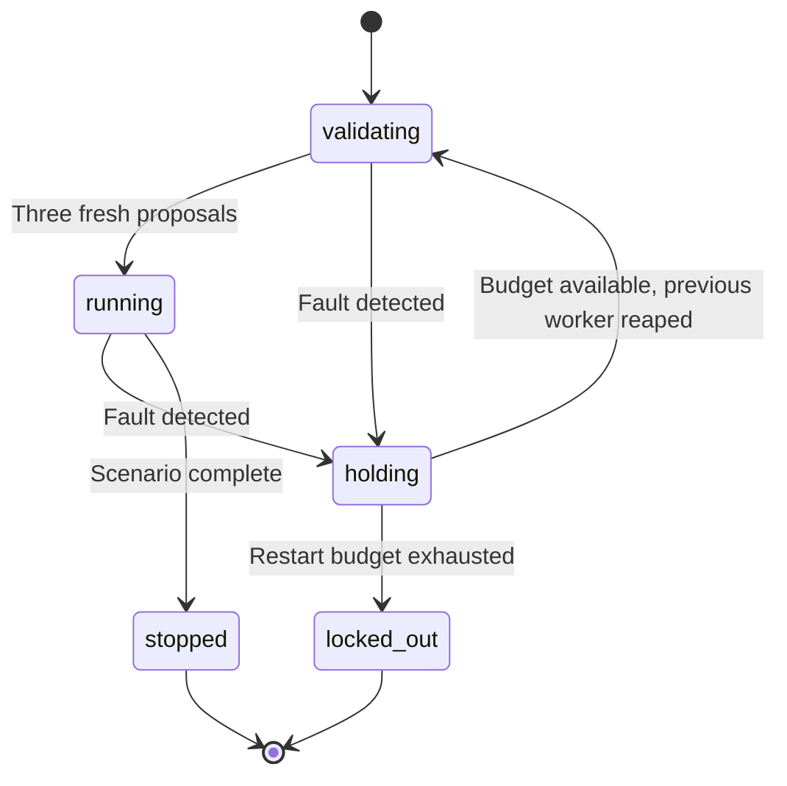

# Architecture

Recovery Lab is a developer fault-injection experiment for QNX 8.0. A supervisor owns a simulated numeric output. A separate worker proposes values over native QNX message passing. The supervisor validates messages, holds output during faults, and applies a bounded restart policy.

The output is an integer in supervisor memory. The experiment demonstrates process recovery and message validation with a deliberately controlled worker.

## Execution and evidence

| Layer | What executes | What establishes the result |
| --- | --- | --- |
| Cross-compilation | Windows-hosted `qcc` compiles the C source and `mkqnximage` assembles an x86-64 QNX image | Compiler exit status, build flags, and source/executable/image digests |
| QNX guest execution | The native supervisor and worker execute on QNX 8.0.0 inside QEMU TCG | Guest environment/configuration records, ordered events, scenario summaries, and guest exit markers |
| Recorded replay | JavaScript presents archived guest events in a browser | The selected JSON trace, its raw console/source evidence, and the demo manifest |

The Python checker and exporter run on the host. The browser's playback controls select recorded events. The final video first observes a new owned QNX execution through its serial stream, then records that replay. Its native capture receipt binds the movie to the fresh run, console, source and recorder hashes. A successful build, a verified guest run, and a browser replay each provide evidence for their own layer.

## Native process model

The implementation is [recovery_lab.c](../prototype/src/recovery_lab.c). One executable starts as either the supervisor or an isolated worker process.

| API | Role in the executed program |
| --- | --- |
| `ChannelCreate`, `ChannelDestroy` | Create and clean up the supervisor's QNX channel |
| `ConnectAttach`, `ConnectDetach` | Connect workers and the timer pulse source to that channel |
| `MsgSend`, `MsgReceive`, `MsgReply` | Carry proposals and fault notices, obtain sender metadata, and release synchronous senders |
| `TimerTimeout` | Bound worker send/reply waits and supervisor receive waits |
| `SIGEV_PULSE_INIT`, `timer_create`, `timer_settime` | Deliver periodic monotonic timer pulses for lifecycle and watchdog checks |
| `posix_spawn`, `kill`, `waitpid` | Start a worker, terminate it when necessary, and reap it before replacement |
| `clock_gettime(CLOCK_MONOTONIC)` | Timestamp events and evaluate elapsed deadlines inside the guest |

The supervisor replies to a synchronous sender before performing lifecycle actions. Application-level acceptance happens after field validation. This ordering releases the sender while preserving the supervisor's sole authority over accepted output.

## Message and output rules

A proposal carries protocol magic, protocol version, message kind, worker generation, sequence number, and an integer value. The supervisor checks the sender PID against its owned worker, exact message size, protocol fields, active generation, next expected sequence, permitted message kind, command range, and proposal freshness. Valid command values are 20 through 60.

Output begins at zero. Three fresh accepted proposals are required before the supervisor releases a worker's numeric command. Each replacement starts a new generation with its sequence and fresh-validation counters reset. A rejected proposal from the active worker holds output at zero before the recovery decision is recorded.

The `wrong_generation` scenario deliberately sends generation 0 from the active generation-1 worker. It exercises the generation-field check. The sender PID check is an additional implemented check, and the experiment's generation scenario supplies a malformed message from the current worker.

Unexpected faults and runtime errors enter `failed`, hold output at zero, and take the owned resources through cleanup. The supervisor refreshes its monotonic timestamp after `posix_spawn` succeeds, so worker startup overhead precedes that worker's initial watchdog interval.

## Seven fault scenarios

| Scenario | Worker behavior | Expected evidence |
| --- | --- | --- |
| `healthy` | Sends valid proposals | Initial three-proposal validation, steady accepted output, clean completion |
| `crash` | Announces injection and exits with code 42 | Observed process exit, hold, replacement, fresh validation, resume |
| `stall` | Announces injection and stops sending | Watchdog detection, hold, replacement, fresh validation, resume |
| `invalid` | Proposes 999 | `command_range` rejection and zero output before recovery |
| `crash_loop` | Crashes at the injection sequence in each generation | Bounded replacements followed by `locked_out` with output zero |
| `replay` | Repeats the preceding sequence | `sequence` rejection despite an in-range numeric value |
| `wrong_generation` | Sends generation 0 | `generation` rejection with both received and active generations recorded |

With a restart limit of zero, each detected injected fault ends in zero-output containment. A `contained` outcome passes when this is the configured expected behavior. A `failed` outcome reports an unsuccessful experiment. The checker evaluates the event sequence in addition to the summary's pass flag.

## Host orchestration and publication

[run-lab.ps1](../prototype/run-lab.ps1) creates the local work directory, cross-compiles the program, builds the image, and starts a background QEMU guest. It holds a per-work-directory run lock and uses a disposable disk copy. The recorded configuration uses one virtual CPU, 512 MiB of memory, software TCG emulation, and networking disabled.

The runner captures `RECOVERY_ENV`, `RECOVERY_CONFIG`, `RECOVERY_EVENT`, and exit-marker lines from the guest serial console. After the exit marker, it stops QEMU and rereads the closed console file before hashing the evidence. It archives the JSON report, console log, and matching C source snapshot.

The publication path then runs two host checks.

1. [check_trace.py](../prototype/check_trace.py) verifies event-level invariants, expected injections, valid sequences/generations, zero-output containment, restart counts, fresh validation, and recorded outcomes.
2. [export_report.py](../prototype/export_report.py) additionally compares the JSON events and environment/configuration against the raw console, checks successful exit markers and console/source digests, and writes Markdown, JUnit XML, and a digest manifest.

`artifacts/latest.json` advances after successful verification and export. A failed attempt retains the preceding verified report and records its status in `latest-attempt.json`. A completed failed guest trace remains available under its immutable run filename. The viewer displays running or failed attempt status alongside the last verified recording.

The digests and correspondence checks support reproducibility and detection of evidence drift. Their trust boundary is the local host that produced and archived the run.

## Replay and presentation

[viewer/index.html](../prototype/viewer/index.html) provides exact-event stepping, scenario filters, state intervals, measured response milestones, import/export, and a command helper for the next run. Its combined timeline places separate scenarios sequentially with labeled 50 ms display gaps. The source `t_ms` fields and exported JSON retain their original per-scenario values.

[demo/index.html](../prototype/demo/index.html) provides four presenter chapters. Guided moments preserve the separate rejection, zero-output hold, restart, fresh-proposal, and resume or lockout events, including events sharing a timestamp. Presentation pauses adapt to explanation length and reduced-motion preference. Guest timestamps remain visible independently of presentation pace.

[build_demo.py](../prototype/build_demo.py) verifies two pinned recordings and packages their JSON, raw console logs, source snapshots, and reports. The generated manifest includes source trace names, configuration, outcomes, counts, and SHA-256 digests. The standalone `offline.html` embeds this evidence and the UI assets. The served demo can link an exact event to the full viewer through its source recording filename.

| Pinned recording | Events | Injection sequence | Watchdog | Restart limit | Recorded outcomes |
| --- | --- | --- | --- | --- | --- |
| `run-20261122-011701-835.json` | 203 | 8 | 700 ms | 2 | 1 healthy, 5 recovered, 1 contained |
| `run-20261122-011927-411.json` | 112 | 8 | 700 ms | 0 | 1 healthy, 6 contained |

These 315 events compare the restart budget with matching fault and watchdog settings. Both recordings contain seven passing scenario assessments.

## Timing and scope

Event times and recovery delays use the guest monotonic clock under software emulation. A separate archived 300 ms watchdog stress run, `run-20261122-011802-242.json`, failed in the healthy scenario after a 332 ms interval without an accepted proposal. That trace records `heartbeat_timeout`, `unexpected_fault`, and a failed assessment. Host scheduling and emulation load affect this experiment's observations.

The implementation and recordings demonstrate the stated IPC, validation, process lifecycle, and containment behavior. Physical I/O, hardware timing guarantees, and safety certification require separate work and evidence.

## Repository map

| Location | Contents |
| --- | --- |
| `prototype/src/` | Native QNX C implementation |
| `prototype/run-lab.ps1` | Windows build, guest execution, verification, and evidence publication |
| `prototype/check_trace.py`, `export_report.py` | Host-side event checks and evidence export |
| `prototype/tests/` | Python regression tests using retained archives and explicit synthetic mutations |
| `prototype/viewer/` | Detailed trace inspection UI |
| `prototype/demo/` | Presenter UI and generated, pinned recorded evidence |
| `prototype/tools/record-demo.cjs` | Optional headless browser screencast and caption capture |
| `prototype/artifacts/` | Retained reports, logs, source snapshots, attempt status, and demo archive |
| `work/` | Local VM images, licensed build outputs, and optional browser tool caches |

See [Reproduce the project](reproduce.md) for commands and prerequisites.
